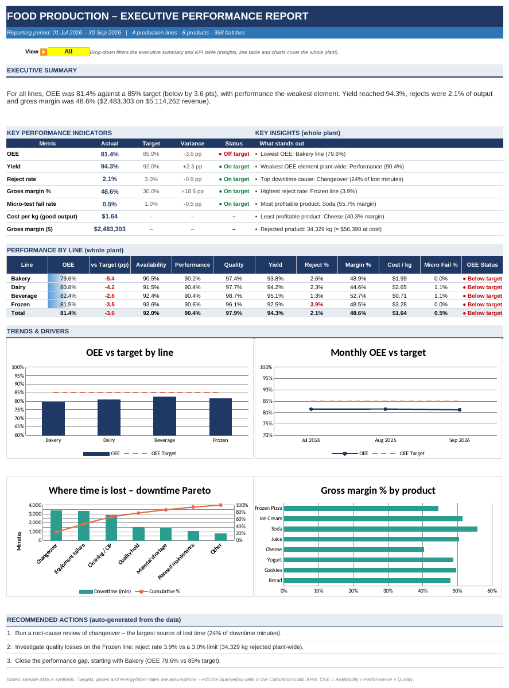

# Food Production Analytics – OEE & Cost Dashboard (Excel)

An end-to-end production analytics project for a food manufacturer: raw batch records → formula-driven calculations → an interactive dashboard that answers **"How efficiently are our lines running, where do we lose time and product, and how profitable is each product?"**

## Business questions
1. What is the OEE (Overall Equipment Effectiveness) of each production line vs the 85 % target?
2. Where is production time lost (downtime Pareto)?
3. What are the reject rates by line and product?
4. What are the cost per kg and gross margin by line and product?
5. Do shifts perform differently?

## Project structure
| File | Purpose |
|---|---|
| `Food_Production_Analysis.xlsx` | Final deliverable – 3 tabs: **Raw Data → Calculations → Dashboard** |
| `data/production_raw.csv` | Raw dataset (368 batches, 17 columns) |
| `build_workbook.py` | Python script that generates the synthetic data and builds the workbook |
| `images/dashboard.png` | Dashboard screenshot |

## Workbook tabs
- **Raw Data** – one row per production batch: date, shift, line, product, planned/produced/rejected quantity, planned time, downtime (+ reason), ideal rate, raw-material input & cost, energy, labor hours, micro test.
- **Calculations** – 500+ live formulas (`SUMIFS`, `COUNTIFS`, `SUMPRODUCT`, `EDATE`): KPIs by line, product, month and shift; downtime Pareto; revenue, cost and margin. Targets and prices are editable (blue on yellow).
- **Dashboard** – one-page *executive report*: auto-written headline summary, KPI table with target/variance/status, key insights and recommended actions generated by formulas, line scorecard with data bars, and 4 charts (OEE vs target, monthly trend, downtime Pareto, margin by product). Line selector drop-down filters the summary and KPI table.

## KPI definitions
- **Availability** = (planned time − downtime) ÷ planned time
- **Performance** = actual output ÷ (run time × ideal rate)
- **Quality** = good kg ÷ produced kg
- **OEE** = Availability × Performance × Quality
- **Cost / kg** = (material + energy + labor) ÷ good kg
- **Gross margin** = revenue − total cost

## Key findings (sample data)
- Plant OEE is **81.4 %** vs an 85 % target – **Performance (90.4 %)** is the weakest component, not Quality (97.9 %).
- **Changeover (24 %), equipment failure (23 %) and cleaning/CIP (20 %)** cause two-thirds of downtime (3 reasons ≈ 67 %).
- **Frozen** has the highest reject rate (**3.9 %**, above the 3 % limit).
- **Shift C** has the lowest OEE (80.0 % vs 82.1 % on A and B) and the highest reject rate.
- Gross margin is **48.6 %** overall; **Soda (55.7 %)** is the most profitable product and **Cheese (40.3 %)** the least, because of its high raw-material cost.

> ⚠️ Data is **synthetic** (generated by `build_workbook.py`). Prices, targets and energy/labor rates are assumptions – findings illustrate the analysis, not a real plant.

## How to use with your own data
Paste your batch data into `Raw Data` from row 2 (same columns, up to row 1000), update targets/prices in `Calculations`, and the dashboard updates automatically.

## Skills demonstrated
Excel (advanced formulas, executive dashboard with dynamic text, data validation, conditional formatting, charts) · manufacturing KPIs (OEE, Pareto) · cost & margin analysis · data storytelling · Python (`openpyxl`)
